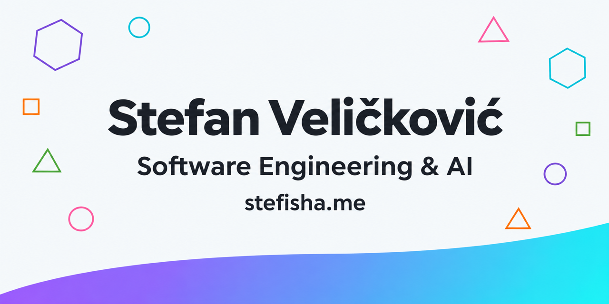

## Hi, I’m Stefan 👋

**Senior Software Engineer | Agentic AI, Secure Tool Use & Fintech**

I build AI systems that connect with real tools, APIs and business workflows. My work combines applied machine learning, backend engineering and reliable automation for financial services.

I hold an MSc from the University of Belgrade, School of Electrical Engineering.

### 🚀 Work & ventures

- 🏢 **Sokin:** Senior Software Engineer working on AI integrations and financial services.
- 🌱 **[Joint Venture](https://jointventurefi.com/):** Co-founder, remaining involved alongside my main role.
- 🛠️ **Previously, [GitWork](https://github.com/stefisha/GitWork):** Co-founded a platform connecting GitHub contributions with Solana bounties. The project is now retired.

## 🌐 Find me online:

## 📞 Let’s connect

Happy to connect about AI engineering, fintech, or building useful software.

[📅 Book a 30-minute chat](https://calendly.com/stefan-velickovic/30min) · [✉️ Email me](mailto:stefanhrmail@gmail.com)

---

## 💻 Tech stack

### Languages & applications

### AI, agents & data

### Cloud & delivery

More tools I work with: Flask, NumPy, Matplotlib, Terraform, SQL and MongoDB.

---

## 📊 GitHub Stats:

<!-- Cards refresh daily via .github/workflows/update-profile-cards.yml.
     Failed refreshes preserve the last successful cards. -->

---

