# 👋 Hi, I'm Stefan Veličković

**Senior Software Engineer | Agentic AI, Secure Tool Use & Fintech**

I build agentic AI systems, secure tool integrations, and reliable automation. My focus is applied AI, Retrieval-Augmented Generation (RAG), and dependable software for financial services. I previously co-founded **[GitWork](https://github.com/stefisha/GitWork)**, an open-source developer platform that is currently on hiatus.

## 🚀 What I'm doing right now
* 🏢 **@ Sokin:** Senior Software Engineer working in financial services.
* 🧠 **Focus:** Agentic AI, secure tool use, RAG, and reliable automation.
* 🛠️ **Previously:** Co-founded GitWork, connecting GitHub issues with Solana bounties. The project is currently on hiatus.

## 🧠 My Expertise
* **AI Engineering:** Agentic AI, secure LLM tool use, LLM orchestration (LangChain), RAG architectures, applied machine learning.
* **Infrastructure & DevOps:** Containerization (Docker/K8s), CI/CD pipelines, secure enterprise cloud deployments.
* **Backend & Fintech:** Python, API integration, financial workflows, secure automation.

## 🌐 Find me online:

## 📞 Let's connect:
Schedule a 30-minute get-to-know call: https://calendly.com/stefan-velickovic/30min
📫 Or email me directly: stefanhrmail@gmail.com

---

## 💻 Tech Stack

### Languages & Web

### AI & Data

### Cloud & DevOps

### Databases

---

## 📊 GitHub Stats:

<!-- Cards refresh daily via .github/workflows/update-profile-cards.yml.
     Failed refreshes preserve the last successful cards. -->

---

